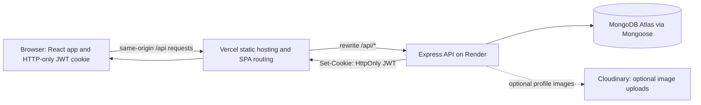

# Online Quiz Platform

A full-stack quiz and learning platform with separate student, teacher, and parent flows. Teachers create classes and scheduled quizzes; students enroll, complete quizzes, and track results; parents use a student-issued access code to view linked quiz results and low-score alerts.

> Deployment URLs below are placeholders, not live deployments. Replace them after hosting the project.

- **Live app:** `https://<your-vercel-project>.vercel.app`
- **API health through the app:** `https://<your-vercel-project>.vercel.app/api/health`
- **Direct API health (optional):** `https://<your-render-service>.onrender.com/api/health`

## Roles and features

### Student

- Sign up and log in; join a class using its teacher-provided enrollment code.
- View enrolled classes and available, upcoming, and active quizzes.
- Take multiple-choice, true/false, and short-answer quizzes; review marks and submissions.
- View overall and per-class analytics, including attempts, marks, averages, recent results, and monthly trends.
- Submit class ratings (`good`, `average`, or `bad`) and comments; request teacher consultations and exchange messages after a request is accepted.
- Use the study chatbot for quiz, class, performance, study-planning, and motivation prompts.
- Generate a parent access code from the authenticated student account and share it with a parent.

### Teacher

- Create classes with enrollment codes and view/manage their classes.
- Create, schedule, publish, and update quizzes; review submissions and grade short answers.
- View class marks and class ranking information; view class rating statistics and ratings received.
- Provide class feedback, respond to consultation requests, exchange messages, and complete consultations.

### Parent

- Log in with the student's email and the access code generated by that student. Parent accounts are linked to a student; a student can replace the code to revoke the previous code.
- View the child's quiz results and result details, plus low-score notifications (the parent endpoint treats scores below 30% as low).

### Shared platform features

- Cookie-backed JWT authentication and role checks on protected operations.
- In-app notifications with unread counts, pagination, and mark-read actions.
- Overall and class rankings.
- Class feedback from teachers and enrolled students.
- Student-teacher consultations with pending, accepted, and completed states.

## AI chatbot: implementation note

Despite the UI labels, the current chatbot is **rule-based; it does not call an external AI/LLM service**. The backend matches message keywords and phrases, uses simple keyword sentiment checks, and builds responses from templates and the student's classes, graded quiz performance, and upcoming quizzes. Recent conversation context is held in a process-local in-memory map, not a database. It is lost on server restart and is not shared across multiple backend instances. The file attachment control currently adds a filename/size message in the UI; it does not upload or analyze the file.

## Tech stack

| Area | Technologies in this repository |
|---|---|
| Frontend | React 18, React Router 6, Zustand, Axios, Vite 6, Tailwind CSS 3 |
| Backend | Node.js (ES modules), Express 5, Mongoose 8, MongoDB |
| Authentication and validation | `jsonwebtoken`, `bcryptjs`, HTTP-only JWT cookie, Zod |
| Supporting services | Cloudinary (optional profile-image uploads) |
| Middleware/build tools | `cookie-parser`, CORS, dotenv, PostCSS, Autoprefixer, ESLint |

The repository does not pin a Node.js version in `engines`; use a Node.js version supported by the listed dependencies. Frontend and backend dependencies are installed separately from their respective lockfiles.

## Architecture



Locally, Vite proxies `/api` to the backend on port 5001. In production, Vercel rewrites `/api/*` to Render and falls back to `index.html` for React Router paths. See [deployment instructions](docs/deployment.md) for provider setup and cookie/CORS details.

## Repository structure

```text
.
├── backend/
│   ├── src/
│   │   ├── controllers/      # Auth, classes, quizzes, analytics, chat, etc.
│   │   ├── lib/              # Database, token, Cloudinary, validation helpers
│   │   ├── middlewares/      # Authentication and signup validation
│   │   ├── models/           # Mongoose models
│   │   ├── routers/          # Express API route groups
│   │   ├── app.js
│   │   └── server.js
│   ├── package.json
│   └── package-lock.json
├── frontend/
│   ├── public/
│   ├── src/
│   │   ├── components/
│   │   ├── lib/
│   │   ├── pages/
│   │   ├── store/            # Zustand stores
│   │   ├── stores/           # Additional feature stores
│   │   ├── App.jsx
│   │   └── main.jsx
│   ├── vercel.json
│   ├── package.json
│   └── package-lock.json
├── docs/
│   ├── deployment.md
│   ├── ANALYTICS_FEATURE.md
│   └── qa/
├── render.yaml
└── README.md
```

## Local setup

### Prerequisites

- Node.js and npm.
- A MongoDB connection string (MongoDB Atlas or a reachable MongoDB deployment).

Clone the repository and enter its root:

```sh
git clone https://github.com/MehediSwoccho/online_quiz_platform.git
cd online_quiz_platform
```

### Configure the backend

1. Create `backend/.env` locally; keep it out of version control.
2. Set the backend variables in the table below. For the default local frontend, include `http://localhost:5173` in `CLIENT_URL` so browser requests pass CORS.
3. Install and start the backend:

```sh
cd backend
npm ci
npm start
```

The backend listens on `PORT` when supplied, or `5001` by default. `GET http://localhost:5001/api/health` is the health check.

For auto-restart during development, use `npm run dev` instead of `npm start`.

### Configure and start the frontend

In a second terminal:

```sh
cd frontend
npm ci
npm run dev
```

Open the local Vite URL printed in the terminal (normally `http://localhost:5173`). The dev server proxies `/api` to `http://localhost:5001`.

### Environment variables

Never put production credentials in frontend variables or commit `.env` files. Optional Cloudinary settings should be configured as a complete set; with any missing key the server still starts, but image uploads return HTTP 503.

| Variable | Used by | Required | Description |
|---|---|---:|---|
| `MONGODB_URI` | Backend | Yes | MongoDB connection string used by Mongoose. |
| `JWT_SECRET` | Backend | Yes | Secret used to sign and verify session JWTs. Use a strong, private value. |
| `CLIENT_URL` | Backend | Yes for browser use | Comma-separated exact allowed frontend origins. For local development, include the Vite origin; in production, use the deployed Vercel origin. |
| `PORT` | Backend | No | Listening port; defaults to `5001`. The hosting platform normally supplies it in production. |
| `NODE_ENV` | Backend | No locally | Set to `production` in production so the JWT cookie is `Secure`. |
| `CLOUDINARY_CLOUD_NAME` | Backend | Optional | Cloudinary account name. Configure together with the API key and secret. |
| `CLOUDINARY_API_KEY` | Backend | Optional | Cloudinary API key. Configure together with the other Cloudinary values. |
| `CLOUDINARY_API_SECRET` | Backend | Optional | Cloudinary API secret. Configure together with the other Cloudinary values. |
| `VITE_API_URL` | Frontend | No | Optional API base URL override. Defaults to `/api`; leave unset for Vite proxying and production same-origin Vercel rewrites. This is public build-time configuration, not a secret. |

## API endpoint summary

All routes below are prefixed with `/api`. Unless noted as public, routes require the JWT cookie. Role and resource checks are also applied by the relevant handlers.

| Area | Endpoints | Purpose |
|---|---|---|
| Health | `GET /health` | Public health status. |
| Auth | `POST /auth/signup`, `POST /auth/login`, `POST /auth/parent-login`, `POST /auth/logout`, `GET /auth/check` | Signup, student/teacher login, code-based parent login, logout, and session check. Signup/login and parent login are public; check returns the current session identity when a valid cookie is present. |
| Auth/profile | `POST /auth/parent-access-code`, `PUT /auth/update-profile` | Protected student code generation and protected profile updates. |
| Classes | `POST /classes/create`, `GET /classes/teacher-classes`, `POST /classes/enroll`, `GET /classes/student-classes`, `GET /classes/:classId` | Teacher class creation/listing, student enrollment/listing, and authorized class details. |
| Quizzes | `POST /quizzes/create`, `GET /quizzes/class/:classId`, `GET /quizzes/upcoming`, `GET /quizzes/:quizId`, `PUT /quizzes/:quizId`, `POST /quizzes/:quizId/publish` | Quiz creation, listings, details, updates, and publishing. |
| Quiz attempts | `POST /quizzes/:quizId/start`, `POST /quizzes/submission/:submissionId/answer`, `POST /quizzes/submission/:submissionId/complete` | Student quiz attempts and answer/completion handling. |
| Quiz grading/results | `POST /quizzes/submission/:submissionId/grade`, `GET /quizzes/:quizId/submissions`, `GET /quizzes/:quizId/submission`, `GET /quizzes/class/:classId/marks` | Teacher grading and class/quiz submission or marks views. |
| Analytics | `GET /analytics/student`, `GET /analytics/class/:classId` | Student-only overall and enrolled-class analytics. |
| Rankings | `GET /rankings/overall`, `GET /rankings/class/:classId` | Overall and class rankings. |
| Parent | `GET /parent/quiz-results`, `GET /parent/quiz-results/:submissionId`, `GET /parent/notifications` | Linked child's quiz results, result detail, and low-score notifications; protected parent routes. |
| Chatbot | `POST /chatbot/chat`, `GET /chatbot/history`, `GET /chatbot/capabilities` | Protected student chatbot, process-local history, and capability metadata. |
| Notifications | `GET /notifications`, `GET /notifications/unread-count`, `PUT /notifications/:notificationId/read`, `PUT /notifications/mark-all-read` | Per-user notification listing, unread count, and read state. |
| Feedback | `POST /feedback/teacher`, `POST /feedback/student`, `GET /feedback/class/:classId` | Class feedback by the class teacher or enrolled students, and authorized listing. |
| Consultations | `POST /consultations/request`, `GET /consultations/student`, `GET /consultations/teacher`, `PUT /consultations/accept/:consultationId`, `GET /consultations/:consultationId`, `POST /consultations/:consultationId/message`, `PUT /consultations/:consultationId/complete` | Student requests, teacher handling, participant conversation, and completion. |
| Ratings | `POST /ratings/submit`, `GET /ratings/student/:classId`, `DELETE /ratings/student/:classId`, `GET /ratings/class/:classId/stats`, `GET /ratings/teacher` | Student class ratings and teacher rating/statistics views. |

## Tests and checks

There is no configured automated unit/integration test suite or `npm test` script in either package. Available checks are:

```sh
# Backend: syntax check for the server entry point
cd backend
npm run build

# Frontend: lint and production compilation
cd frontend
npm run lint
npm run build
```

`backend`'s `build` script only runs `node --check src/server.js`; it is not a behavioral test. `frontend`'s lint script runs ESLint. In the checked workspace snapshot, lint reports existing errors and warnings; run it for the current file-level diagnostics.

For a manual smoke test, configure the backend and database, start both servers, then sign up a teacher and student, create a class and enroll the student, create/publish a quiz, submit an attempt, review or grade its result, and check analytics, notifications, ratings, consultations, parent access-code login, and `GET /api/health`.

## Demo screenshots

Replace these placeholders with screenshots captured from a running deployment (avoid including personal data or session cookies):

- Student home and analytics: _Screenshot placeholder — add `docs/screenshots/student-home.png`._
- Teacher class and quiz management: _Screenshot placeholder — add `docs/screenshots/teacher-classes.png`._
- Parent results dashboard: _Screenshot placeholder — add `docs/screenshots/parent-dashboard.png`._

## Known limitations

- The chatbot is heuristic/template-based rather than connected to a generative AI service; its in-memory chat history is not durable or shared across server instances.
- The chatbot attachment control does not upload or process files.
- Cloudinary is optional, but profile-image uploads are unavailable until all three Cloudinary variables are configured.
- Automated unit/integration tests are not configured, and the current frontend lint run reports errors and warnings.
